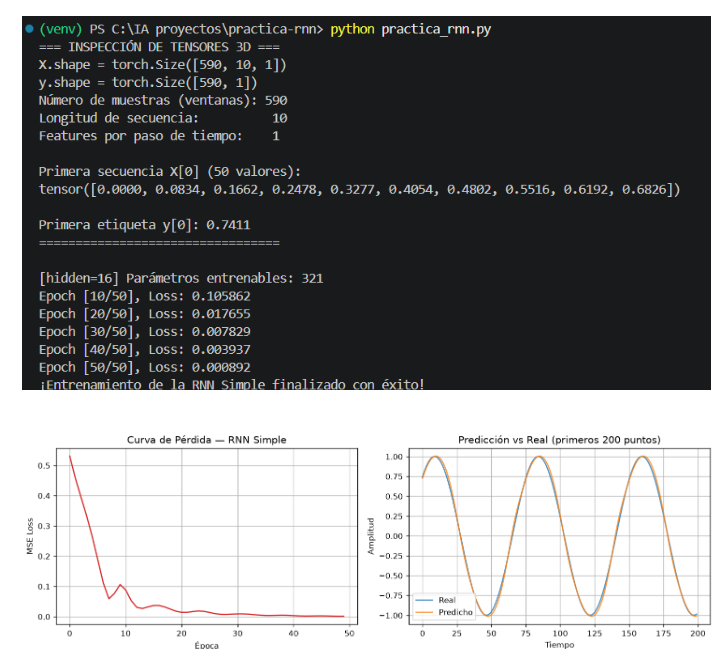
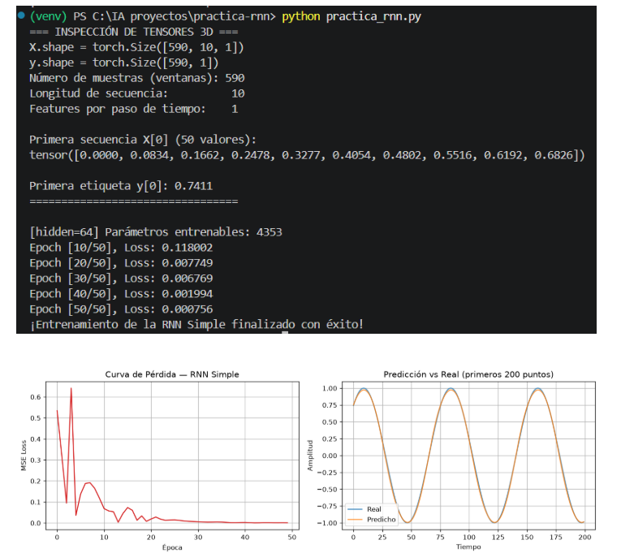
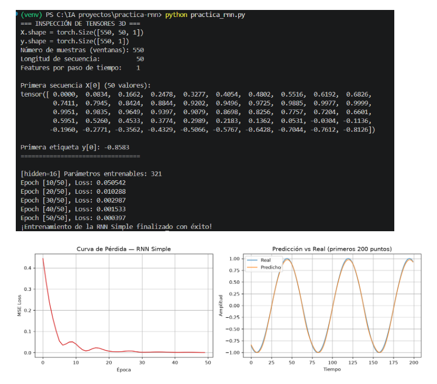
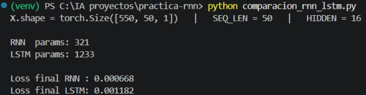
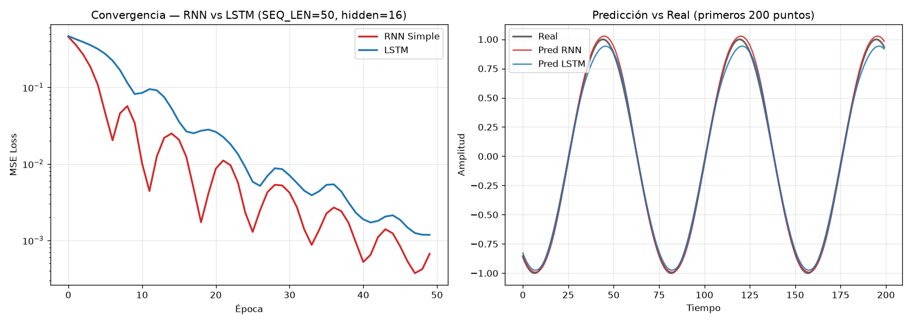

# Lab 06: Redes Neuronales Recurrentes (RNN y LSTM)

**Universidad Andina del Cusco**

**Facultad:** Ingeniería y Arquitectura  
**Escuela Profesional:** Ingeniería de Sistemas  
**Curso:** Inteligencia Artificial  
**Docente:** Lazo Mamani, Juan Carlos  
**Tema:** Arquitecturas Recurrentes y Análisis de Resultados (RNN simple vs. LSTM)  
**Integrantes:** Delgado Ccorihuaman, Hamlet Nayeli / Leva Ayte, Kelma Ivonne

---

## Estructura del repositorio

```
lab6-RNN-LSTM/
├── practica_rnn.py
├── comparacion_rnn_lstm.py
├── comparacion_rnn_lstm.png
├── README.md
└── .gitignore
```

---

## Parte 1: Inspección de Dimensiones (Tensores 3D)

Se añadieron las instrucciones `print(X.shape)` y `print(y.shape)` antes de iniciar el entrenamiento para inspeccionar las dimensiones de los tensores.

**Resultados obtenidos en consola:**

```
X.shape = torch.Size([590, 10, 1])
y.shape = torch.Size([590, 1])
```

**¿Qué representa exactamente cada eje?**  
El tensor `X` tiene tres dimensiones `[N, L, F]` porque `nn.RNN(..., batch_first=True)` espera esta estructura. Para el caso con `n_puntos = 600` y `SEQ_LEN = 10`:

| Eje | Nombre | Valor | Significado |
|-----|--------|-------|-------------|
| 0 | Batch Size (N) | 590 | Número de ventanas deslizantes generadas: `n_puntos − seq_len = 600 − 10`. Es la cantidad de ejemplos disponibles para el entrenamiento. |
| 1 | Sequence Length (L) | 10 | Cantidad de pasos temporales que la RNN recorre secuencialmente en cada ventana. |
| 2 | Features (F) | 1 | Cantidad de variables registradas en cada paso temporal. Aquí solo se usa el valor de la señal senoidal. |

**¿Por qué `y` tiene solo 2 dimensiones?**  
El tensor `y` tiene forma `[590, 1]` porque contiene 590 valores objetivo, uno por cada ventana de entrada. Cada valor corresponde al siguiente valor de la señal senoidal. A diferencia de `X`, que incluye muestras, pasos temporales y características, `y` solo necesita representar las muestras y sus valores objetivo.

Esto corresponde a un enfoque **Many-to-One**: la red utiliza una secuencia de 10 pasos temporales para generar una única predicción.

**RESULTADO**


---

## Parte 2: Modificación de Hiperparámetros

Se modificó el parámetro `hidden_size` de 16 a 64 para observar su impacto en el número de parámetros entrenables del modelo.

**Fórmulas para calcular los parámetros** (con \(H\) = `hidden_size`):

\[
\text{RNN} = H^2 + 3H
\]

\[
\text{Capa de salida (FC)} = H + 1
\]

\[
\text{Total} = H^2 + 4H + 1
\]

**Verificación de los cálculos:**

\[
H = 16: \quad 16^2 + 4(16) + 1 = 256 + 64 + 1 = 321
\]

\[
H = 64: \quad 64^2 + 4(64) + 1 = 4096 + 256 + 1 = 4353
\]

**Resultados obtenidos:**

| Configuración | hidden_size | Parámetros entrenables | Loss final (época 50) |
|---------------|-------------|------------------------|-----------------------|
| Baseline | 16 | 321 | 0.000892 |
| Modificada | 64 | 4,353 | 0.000756 |

**Análisis:**  
- Al cambiar `hidden_size` de 16 a 64, los parámetros entrenables pasaron de 321 a 4,353, es decir, aproximadamente **13.6 veces más**.  
- Esto ocurre porque la RNN contiene una matriz de pesos recurrentes cuyo tamaño crece **cuadráticamente** con `hidden_size`.  
- La pérdida final mejoró ligeramente (0.000892 → 0.000756), pero la diferencia es pequeña frente al aumento de parámetros.

**Conclusión:** para predecir una serie senoidal, `hidden_size = 16` es suficiente, ya que ofrece buenos resultados con muchos menos parámetros que `hidden_size = 64`.

**RESULTADO:**


---

## Parte 3: Análisis de Ventanas Temporales

Se incrementó la longitud de la secuencia (`SEQ_LEN`) de 10 a 50 pasos temporales para analizar su impacto en la estabilidad del entrenamiento y en la pérdida (Loss).

**Resultados obtenidos:**

| Configuración | SEQ_LEN | Loss época 10 | Loss época 30 | Loss final (época 50) |
|---------------|---------|---------------|---------------|-----------------------|
| Baseline | 10 | 0.105862 | 0.007829 | 0.000892 |
| Ventana larga | 50 | 0.050542 | 0.002987 | 0.000397 |

**Análisis:**  
Al aumentar `SEQ_LEN` de 10 a 50 pasos temporales, el entrenamiento se volvió más estable y la pérdida disminuyó más rápidamente. Con `SEQ_LEN = 10` la pérdida final fue de 0.000892, mientras que con `SEQ_LEN = 50` bajó a 0.000397.

Esto ocurre porque una ventana más larga proporciona más información temporal para realizar las predicciones. La serie senoidal es relativamente sencilla, por lo que la RNN pudo aprovechar ese contexto adicional sin problemas importantes de estabilidad.

**Conclusión:** aumentar `SEQ_LEN` de 10 a 50 mejoró la convergencia y redujo la pérdida final. No se observaron señales importantes de inestabilidad ni efectos evidentes del problema del gradiente desvaneciente.

**RESULTADO:**


---

## Parte 4: Reto Avanzado, Comparación RNN vs LSTM

Se entrenaron ambos modelos bajo las mismas condiciones: `SEQ_LEN = 50`, `hidden_size = 16`, `lr = 0.01`, 50 épocas y `seed = 42`.

### 1. Comparativa de Métricas

**RESULTADO:**


| Modelo | Parámetros entrenables | Loss final |
|--------|------------------------|------------|
| RNN simple | 321 | **0.000668** |
| LSTM | 1,233 | 0.001182 |

La RNN simple logró ajustarse mejor a la serie temporal (0.000668 frente a 0.001182 de la LSTM). La RNN presentó un descenso más rápido de la pérdida, aunque con algunas oscilaciones durante el entrenamiento. La LSTM mostró una convergencia más suave y estable, pero terminó con una pérdida mayor.

### 2. Análisis de Parámetros

La LSTM tiene cuatro compuertas internas (olvido, entrada, salida y candidata), cada una con su propio conjunto de pesos:

\[
\text{LSTM} = 4 \times (H \cdot 1 + H^2 + 2H) = 4 \times (16 + 256 + 32) = 1216
\]

\[
\text{Total} = 1216 + (H + 1) = 1216 + 17 = 1233
\]

Eso coincide con los **1,233** parámetros obtenidos. Estas compuertas permiten a la LSTM gestionar mejor la información a largo plazo, a costa de unos 3.8 veces más parámetros que la RNN simple.

### 3. Gráfica Comparativa



**Conclusión:** en este experimento, la RNN simple obtuvo mejores resultados y utilizó menos parámetros. Esto se debe a que la serie senoidal es relativamente sencilla y no requiere una memoria compleja a largo plazo. La LSTM podría ofrecer ventajas en tareas con dependencias temporales más complejas.

---

## Conclusión General

Las actividades permitieron comprender la estructura de los tensores utilizados en una RNN, el efecto del parámetro `hidden_size`, la influencia de la longitud de las ventanas temporales y las diferencias entre una RNN simple y una LSTM.

Los resultados muestran que aumentar el tamaño oculto incrementa considerablemente los parámetros entrenables, mientras que utilizar una secuencia más larga mejoró la pérdida final en este experimento. Asimismo, la RNN simple superó a la LSTM en la predicción de la serie senoidal evaluada, con menos parámetros y una pérdida final menor.

En conclusión, la arquitectura y los hiperparámetros deben seleccionarse según la complejidad de la tarea. Una RNN simple puede ser suficiente para patrones periódicos sencillos, mientras que una LSTM puede resultar más útil cuando se necesita aprender dependencias temporales de largo plazo.

---

## Ejecución

```bash
python -m venv venv
venv\Scripts\activate
pip install torch matplotlib numpy
python practica_rnn.py
```

Para la comparación RNN vs LSTM:

```bash
python comparacion_rnn_lstm.py
```

---

## Comandos Git utilizados

```bash
git init
git add .
git commit -m "feat: implementacion inicial de RNN simple con inspeccion de tensores y visualizacion"
git branch -M main
git remote add origin https://github.com/Kel-lev/lab6-RNN-LSTM.git
git push -u origin main
```
